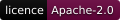

<p align="center">
  <picture>
    <source media="(max-width: 600px) and (prefers-color-scheme: light)" srcset=".github/assets/banner-phone-light.svg">
    <source media="(max-width: 600px)" srcset=".github/assets/banner-phone.svg">
    <source media="(prefers-color-scheme: light)" srcset=".github/assets/banner-light.svg">
    
  </picture>
</p>

<div align="center">

[](https://github.com/yungSNAT/BigSister/actions/workflows/ci.yml?query=branch%3Amain) [](https://app.codecov.io/gh/yungSNAT/BigSister/tree/main) [](https://github.com/yungSNAT/BigSister/actions/workflows/codeql.yml?query=branch%3Amain) [](https://github.com/yungSNAT/BigSister/actions/workflows/osv-scanner.yml?query=branch%3Amain) [](https://sonarcloud.io/summary/new_code?id=yungSNAT_ShaphansAudit)<br>
[](https://scorecard.dev/viewer/?uri=github.com/yungSNAT/BigSister) [](https://github.com/yungSNAT/BigSister/attestations) [](https://github.com/yungSNAT/BigSister/releases/latest) [](https://github.com/yungSNAT/BigSister/releases/latest) [](#licence)

[Install](#install) · [Use](#use) · [Privacy](#privacy) · [Limits](#limits) · [Development](#development) · [Credits](#credits) · [Licence](#licence)

</div>

`bigsister` reads the transcripts that Claude Code, Codex, [pi](https://github.com/earendil-works/pi), [OpenCode](https://github.com/anomalyco/opencode), [Gemini CLI](https://github.com/google-gemini/gemini-cli) and [Qwen Code](https://github.com/QwenLM/qwen-code) save on your machine and reports where tokens and checks are wasted, from context loaded before the first reply to slow hooks; the table under [Use](#use) lists each measure. For any other agent that records OpenTelemetry GenAI spans, it reads the OTLP/JSON trace files in a folder you name (`--otlp-root`) for cost by model and tool errors.

It prints names, paths, counts, sizes and times, as listed under [Privacy](#privacy). It never prints message text, tool inputs or tool outputs, and it makes no network calls.

## Install

Each [release](https://github.com/yungSNAT/BigSister/releases) carries 6 prebuilt executables for Linux (`x86_64` and `aarch64`, statically linked with musl), macOS (`x86_64` and `aarch64`) and Windows (`x86_64` and `aarch64`), with a `SHA256SUMS` file, SPDX SBOMs and signed build provenance.

BigSister was called ShaphansAudit at v0.1.0 (executable `shaphan`, repository `yungSNAT/ShaphansAudit`); [RELEASE_NOTES.md](RELEASE_NOTES.md) lists what changed in v0.2.0 for an existing v0.1.0 install.

With the [GitHub CLI](https://cli.github.com/) installed, the installer from [release-policy](https://github.com/ryanduguid/release-policy), which builds the releases, checks who built a release as well as its checksum: it installs nothing unless `gh` verifies `SHA256SUMS` and the archive against the release's signed provenance and the archive matches its `SHA256SUMS` line. It installs into `${XDG_DATA_HOME:-$HOME/.local/share}/bigsister` on Linux and macOS or `%LOCALAPPDATA%\Programs\bigsister` on Windows; `--modify-path` (`-ModifyPath` on Windows) also adds that folder to your `PATH`. On Linux and macOS:

```bash
curl -fsSL https://raw.githubusercontent.com/ryanduguid/release-policy/ffbeffd5ff595b9b2fcaa885395ffb21108aaa2b/scripts/install.sh |
  sh -s -- --modify-path yungSNAT/BigSister v0.2.0
```

On Windows, in PowerShell:

```powershell
$url = 'https://raw.githubusercontent.com/ryanduguid/release-policy/ffbeffd5ff595b9b2fcaa885395ffb21108aaa2b/scripts/install.ps1'
& ([scriptblock]::Create((Invoke-RestMethod $url))) yungSNAT/BigSister v0.2.0 -ModifyPath
```

Without the GitHub CLI, check the checksum yourself. On Linux and macOS, this downloads v0.2.0 (swap `x86_64-unknown-linux-musl` for `aarch64-unknown-linux-musl`, `x86_64-apple-darwin` or `aarch64-apple-darwin` as needed, and use `shasum -a 256 --check` on macOS), stops if the file does not match `SHA256SUMS`, and installs to `~/.local/bin`, which must be on your `PATH`:

```bash
base=https://github.com/yungSNAT/BigSister/releases/download/v0.2.0
asset=bigsister-0.2.0-x86_64-unknown-linux-musl.tar.gz
curl -fsSLO "$base/$asset" && curl -fsSLO "$base/SHA256SUMS" &&
  awk -v f="$asset" '$2 == f' SHA256SUMS | sha256sum --check &&
  mkdir -p ~/.local/bin && tar -xzf "$asset" -C ~/.local/bin bigsister &&
  ~/.local/bin/bigsister --version
```

On Windows, in PowerShell (swap `x86_64-pc-windows-msvc` for `aarch64-pc-windows-msvc` on arm64):

```powershell
$base = 'https://github.com/yungSNAT/BigSister/releases/download/v0.2.0'
$asset = 'bigsister-0.2.0-x86_64-pc-windows-msvc.zip'
Invoke-WebRequest "$base/$asset" -OutFile $asset
Invoke-WebRequest "$base/SHA256SUMS" -OutFile SHA256SUMS
$sum = (Select-String -Path SHA256SUMS -SimpleMatch $asset).Line.Split(' ')[0]
if ((Get-FileHash $asset -Algorithm SHA256).Hash -ne $sum) { throw 'checksum mismatch' }
Expand-Archive $asset "$env:LOCALAPPDATA\Programs\bigsister" -Force
& "$env:LOCALAPPDATA\Programs\bigsister\bigsister.exe" --version
```

A matching checksum shows the download is intact, not who built it. To check that too, run `gh attestation verify <file> --repo yungSNAT/BigSister --signer-workflow ryanduguid/release-policy/.github/workflows/release-binary.yml --source-ref refs/tags/v0.2.0` with the [GitHub CLI](https://cli.github.com/) (for v0.1.0, use `--repo yungSNAT/ShaphansAudit --source-ref refs/tags/v0.1.0`); [Verify a release](https://github.com/ryanduguid/release-policy/blob/main/docs/verify-a-release.md) explains what it proves.

### From source

With Rust 1.99 or later installed, this builds and installs `bigsister`:

```bash
cargo install --locked --git https://github.com/yungSNAT/BigSister bigsister
```

To build from a clone instead, with the compiler pinned in `rust-toolchain.toml` (rustup installs it if needed):

```bash
git clone https://github.com/yungSNAT/BigSister
cd BigSister
cargo install --locked --path .
```

## Use

```bash
bigsister all
```

This reads the last 7 days of `~/.claude/projects`, `~/.codex/sessions`, `~/.codex/archived_sessions`, `~/.pi/agent/sessions`, `~/.local/share/opencode`, `~/.gemini/tmp` and `~/.qwen/projects` and prints one section per detector. If none of them exists, it exits 1, names each missing folder but `~/.codex/archived_sessions`, which need not exist, and suggests the sample below. If the folders exist but no record in them falls in the window, it prints `Nothing scanned` above the sections, whose zeros then mean no records rather than no waste, and exits 0; `--json` gives `records_scanned: false` and each root's `files_with_records`. Run one detector by name, for example `bigsister hooks --since 24h`. The v0.2.0 release predates `diff`, sub-TTL cache-bust attribution, compaction health and truncation re-runs; install from source for `main`. With the v0.1.0 release, run `shaphan` instead; it predates `context`, `tools`, `cache`, `models`, `ranked`, `diff`, `--sample` and the pi, OpenCode, Gemini CLI and Qwen Code readers.

To see a full report before you have transcripts of your own, run it on the sample transcripts built into `bigsister`:

```bash
bigsister all --sample
```

The sample holds synthetic Claude Code, Codex and pi sessions, with a Claude Code request log, and every section finds something in it. It reads none of your folders and writes no file. `--json`, `--csv`, `--limit`, `--agent` and the price options work with it; `--since` and the folder options do not, as the sample has its own window, from 2026-11-01. Hook labels still name only programs found on your machine.

From a clone, this runs it on the synthetic test transcripts:

```bash
bigsister all --since 2026-11-01 --claude-root tests/fixtures/claude --codex-root tests/fixtures/codex
```

Part of its output on a machine without `rtk`, with the `startup`, `context`, `schemas`, `polls` and `rereads` sections left out (hook labels name only programs found on your machine):

```text
bigsister 0.2.0: records since 2026-11-01 00:00 +11:00
claude: 3 files under tests/fixtures/claude (unreadable files or folders: 0, lines skipped: 1, compressed files skipped: 0)
codex: 2 files under tests/fixtures/codex (unreadable files or folders: 0, lines skipped: 0, compressed files skipped: 0)

== pipes: test runs piped into tail or head (Claude and OpenCode Bash, Codex commands, pi bash and powershell, Gemini and Qwen shell) ==
test runs: 5
piped into tail or head: 5
over ssh not judged: 1
guarded with pipefail or pipestatus: 1
unguarded: 3
unguarded results found: 2
unguarded reported success: 2
showed a failure but reported success: 1
showed no pass or fail line: 0
codex outputs not paired: 0

By agent
  agent   test runs  piped into tail or head  over ssh not judged  guarded with pipefail or pipestatus  unguarded  unguarded results found  unguarded reported success  showed a failure but reported success  showed no pass or fail line
  claude          5                        5                    1                                    1          3                        2                           2                                      1                            0
Note: An unguarded pipe reports tail's or head's exit status, not the test runner's.
Note: Fix: set -o pipefail before the pipe, or keep the runner's own exit status.
Note: A Codex command's result is the CommandExecution record Codex wrote as it ended, tied to the command by its text; a command no record ties takes the result its exec cell printed in its place only when the cell printed one result per command and has one command, Codex wrote no such record whilst the cell ran, or it is the one command left untied and each tied command's result is printed whole in its own place. Codex outputs not paired counts the calls with an unguarded test run whose results could not all be paired: a function_call, whose output is not read, or an exec cell that had no call id, whose call id another exec cell in the session had, whose output never came or with a command neither tied nor paired. Codex may run PowerShell, where pipefail does not apply; a failure shown whilst the exit code was 0 is hidden there too.

== hooks: hook runs, cancellations and durations (Claude) ==

By hook name and command, most cancellations first
  hook name             hook           runs  cancelled  timed out  errors  median ms  p90 ms  max ms  median output chars
  PreToolUse:Bash       (other)           1          1          1       0      15000   15000   15000                    -
  SessionStart:startup  hub-digest.js     1          0          0       0        120     120     120                   19
  PreToolUse:Bash       guard.exe         1          0          0       0         40      40      40                    0
```

`context` needs the request log that recent Claude Code versions write into their transcripts; the main fixtures have none, so this shows it on the sample's:

```bash
bigsister context --sample
```

| Command | Agents | Reports |
|---|---|---|
| `ranked` | (from the sections below) | With `all` only, printed first: the largest estimated costs of 4 figures that share one basis (characters a model read divided by 4, at its input price): polls' output, re-reads after compactions, tool schemas loaded but never called and skills listed but never used, each summed over all its rows and ranked by dollars. They can overlap, so they are not added up; cache rebuilds and model choice are priced on other bases and left out |
| `startup` | Claude | Characters loaded before the first non-synthetic reply of each main session, by source: instruction files, hook output, listings, tool schemas and MCP instructions; also the input tokens recorded for that first reply |
| `context` | Claude | Each request Claude Code's request log records, rebuilt: its input's characters by part (system prompt, built-in tools, MCP tools, system messages, reminders, tool results, tool calls, thinking, text, other blocks) and by MCP server, its recorded input tokens split across the parts by their share, and the largest requests; a request naming a message its transcript does not hold counts as partly rebuilt, in no table |
| `schemas` | Claude | Per tool or MCP server: sessions that loaded its schema, sessions that called it, and the characters loaded in sessions that never called it; the same for each skill listed against the skills used |
| `pipes` | Claude, Codex, pi, OpenCode, Gemini, Qwen | Test runs piped into `tail` or `head` without `pipefail` or `PIPESTATUS`, and how many printed a failure whilst the call reported success, in total and by agent |
| `polls` | Claude, Codex, pi, OpenCode, Gemini, Qwen | Commands repeated exactly within a session, split into polls (no file edit since the last run) and reruns after an edit, the polls of a command whose previous run's result was an error, the characters polls returned, each verb class's total command result characters and identical commands re-run within 2 turns of a truncated or stashed output |
| `rereads` | Claude, Codex, pi, OpenCode, Qwen | Files read again after a context compaction that had been read before it, and the characters those re-reads returned; also compactions by recorded trigger (auto or manual) and compaction health: post/pre retention ratio (flagging > 95% drops), thrashing (< 10% saved across 2+ consecutive passes) and post-compaction file-churn/revert loops |
| `tools` | Claude, pi, OpenCode, Gemini, Qwen, OTLP | Per tool: calls, the characters their results returned, errors, and image and document blocks; also runs of 3 or more errors in a row (cascades) and calls repeated with the same input after erring twice (retry churn) |
| `cache` | Claude | Cache write tokens split into new context and context cached again (rebuilt) after an idle gap, a model switch or otherwise, plus sub-TTL (< 5 minute) cache busts classified by cause with raw token share vs cache-weighted USD share divergence |
| `models` | Claude, OTLP | Input-side cost by scope, model, reasoning effort and subagent type, and how many subagent sessions ran on their parent session's top-priced model |
| `hooks` | Claude | Hook runs, cancellations, timeouts and durations, by event, matcher and hook |
| `diff` | Claude, Codex, pi, OpenCode, Gemini, Qwen | Side-by-side comparison (`bigsister diff <before> <after>`) of turns, tokens, cache hit %, cost, sub-TTL cache busts, compactions and waste across 2 session folders or `START..END` time windows |

| Option | Default | Meaning |
|---|---|---|
| `--since` | `7d` | Start of the window: `Nd`, `Nh`, a date (local midnight) or an RFC 3339 time |
| `--sample` | off | Read the sample transcripts built into `bigsister` instead of your folders, from 2026-11-01; not with `--since` or a folder option |
| `--agent` | `all` | `claude`, `codex`, `pi`, `opencode`, `gemini`, `qwen`, `otlp` or `all` |
| `--claude-root DIR` | `~/.claude/projects` | Claude Code transcript folder |
| `--codex-root DIR` | `~/.codex/sessions` and `~/.codex/archived_sessions` | Codex transcript folder; a given folder replaces both |
| `--pi-root DIR` | `~/.pi/agent/sessions` | pi session folder |
| `--opencode-root DIR` | `~/.local/share/opencode` | OpenCode data folder, holding `opencode.db` |
| `--gemini-root DIR` | `~/.gemini/tmp` | Gemini CLI session folder |
| `--qwen-root DIR` | `~/.qwen/projects` | Qwen Code session folder |
| `--otlp-root DIR` | none | Folder of OTLP/JSON trace files holding GenAI spans (`*.json`, `*.jsonl`, `*.jsonl.zst`), as a collector's file exporter writes them; read only when given |
| `--json` | off | Print one JSON object with `schema_version` 2 |
| `--csv` | off | Print the report's sections as one CSV table, one value a record; not with `--json` |
| `--limit N` | 20 | Rows per table |
| `--paths` | off | List the most re-read file paths |
| `--by-branch` | off | Add a `models` table of input-side cost by the Git branch each reply records; off by default, as branch names can be private |
| `--usd-per-mtok USD` | off | Price every token estimate, and `cache`'s write tokens at its write multipliers, at this one rate in US dollars per million tokens, instead of each model's price (above 0, up to 1000) |
| `--prices FILE` | the bundled prices | Price token estimates from this price file instead; not with `--usd-per-mtok` |

To let a coding agent answer plain-language questions such as 'where did my usage go' or 'is my cache expiring' from this report, give it the skill in [`skills/bigsister/SKILL.md`](skills/bigsister/SKILL.md).

Columns ending in `tokens est` (`_tokens_est` in JSON) estimate tokens as the characters beside them divided by 4, rounded up in each row, so rows need not add up to a total. Each is followed by a column ending in `usd est` (`_usd_est`): those characters, divided by 4, at the published price for uncached input of the model whose reply read them, rounded to cents. The prices ship with `bigsister`, read from Anthropic's and OpenAI's pricing pages on 24 November 2026 (every Claude model Anthropic lists as active, and OpenAI's GPT-6, GPT-6.2, GPT-5.6 and Codex models), so pricing makes no network call; a model released or repriced since is not reflected. Claude Haiku 5.5 is priced by the size of the reading reply's prompt (its uncached input, cache writes and cache reads), at the higher price above 100,000 tokens, and OpenAI's GPT-6, GPT-6.2 and GPT-5.6 models by the reading call's prompt (Codex's `input_tokens`), at the long-context price above 272,000 tokens. A Claude result is read by the next reply in its transcript (not a copy of an earlier reply), a Codex result by the next model call of its turn whose usage Codex records (rarely the call that asked for it, when the tool finished first), and an idle tool schema by the session's replies. `unpriced tokens est` counts the part read by a model without a bundled price, by a reply or call of a model priced by prompt size whose prompt size is not recorded, or by no reply, and the idle schemas of a session whose replies used models of different prices. Dollars price each estimate once as uncached input, so they are an illustration, not a bill: cached re-sends cost less, and text kept in context costs again in later turns. `--usd-per-mtok` prices every estimate at one rate instead. `startup`'s recorded request tokens include cache reads, so they are not priced. `context`'s `est input tokens` are not characters divided by 4: they split each request's recorded input tokens (uncached, cache writes and cache reads) across its parts by their share of its characters, so they are estimates too, and are not priced. `cache` prices the write tokens each reply records at the cache write price, 1.25 times the input price for 5-minute writes and 2 times for 1-hour writes. A reply whose usage records no split by lifetime (`replies_without_split`) is priced at the 5-minute rate, and its session's idle cut-off stays at 5 minutes, so such replies can be labelled idle rebuilds after a gap of up to an hour. `models` prices each reply's uncached input at the input price, its cache writes as `cache` does and its cache reads at the model's cache read price (0.025, 0.05 or 0.1 times the input price, from the same page); output tokens are counted, not priced, so its dollars and shares are of input only. Each section with a dollar column gives the price basis in its summary (`usd_basis`): `bundled`, `usd_per_mtok` or `prices_file`. Every dollar figure is an estimate from token counts and prices; none is read from a bill.

`--prices FILE` replaces the bundled prices with a price file, so prices can be kept current without a new release; `bigsister` still makes no network call. A price file is a JSON object keyed by the model id a transcript records, such as `claude-opus-5-5` or `gpt-6.1-sol`. Each entry's `input_cost_per_token` is the price of one uncached input token in US dollars, and an optional `input_cost_per_token_above_<N>k_tokens` is the price when the reading reply's prompt is over N thousand tokens; other fields are ignored. These are the field names of LiteLLM's [`model_prices_and_context_window.json`](https://github.com/BerriAI/litellm/blob/main/model_prices_and_context_window.json), so you can download that file yourself and pass it, or start from the bundled prices in [`src/prices.json`](src/prices.json):

```json
{
  "claude-opus-5-5": {"input_cost_per_token": 4e-06},
  "claude-haiku-5-5": {"input_cost_per_token": 1e-07, "input_cost_per_token_above_100k_tokens": 5e-07}
}
```

A model missing from the file is unpriced, as is one priced by prompt size whose prompt size is not recorded (such as a Codex result no recorded call of its turn reads). A file that cannot be read, is not a JSON object, repeats a key within an object, has an entry that is not an object, a price that is not a number of at least 0 (or is above 0 but below about 2.2e-308, too small to tell from 0), a tier field written another way or no priced model at all stops the run with exit code 1 and names the file and the entry.

`--csv` prints a header, `section,kind,table,row,column,value`, then a record for each value `--json` prints under `detectors`: a section's title (`section_title`), summary pairs (`summary`, with the key as `column`) and notes (`note`), and each table's title (`table_title`), `omitted` count and cells (`cell`, with the column name). Tables and rows are numbered from 0. Each `value` is written as JSON, so text keeps its double quotes and a spreadsheet never reads it as a formula, and a JSON parser gives back the `--json` value. Fields follow RFC 4180, with CRLF line ends. The run header (version, window and folders) is left out.

Exit codes: 0 success, 1 a runtime error such as a missing transcript folder or a bad `--since`, 2 a usage error.

## Privacy

Output holds tool, skill and MCP server names, model ids, reasoning effort labels, subagent types, compaction triggers, instruction file paths, hook names and labels, attachment types, entry points, command verb classes, the scanned folders, counts, sizes and times. Paths under your home folder start with `~`. Re-read file paths appear only with `--paths`, and Git branch names only with `--by-branch`. OpenCode's database also holds account tokens and credentials: `bigsister` reads a copy of it in memory, SQLite refuses it a read of any table but `session`, `message` and `part`, and it takes no lock and opens, writes and creates no file beside the database. From OpenCode's first write after it starts until its write-ahead log is emptied, as on a clean stop, the log holds records and the database counts as unreadable: the report says why beside the count, and the remedy is to quit OpenCode and run again. A killed OpenCode leaves the database unreadable until it next starts and stops cleanly. A tool or skill name, model id, effort label, subagent type or compaction trigger that is not letters, digits and `_`, `-`, `.` or `:` prints as `(other)`, as does a Git branch unless each of its `/`-separated parts is. A verb class or hook label prints only the name of a program found on your machine (a common command, a common PowerShell cmdlet, a program on `PATH` or an existing script); anything else prints as `(other)`, so labels can differ between machines. A script written as a network share path, such as `\\host\share\run.ps1`, is never looked up on disk, because the lookup would contact that host; only its file name is checked. A path your system maps to a network location, such as a drive letter mapped to a share or an automounted folder, is looked up like a local path. Read the output before you share it.

The tests run on synthetic fixtures. They plant sentinel strings in message text, tool inputs, tool outputs and hook commands, and in a probe of each way found so far that input text could reach a verb class, hook label or path, then check that none reaches the output in any letter case.

## Limits

Claude Code's, Codex's, Gemini CLI's and Qwen Code's transcript formats are undocumented and change between releases; Gemini CLI's and Qwen Code's are read as versions 0.69.0 and 0.28.0 wrote them on 19 November 2026, and Gemini CLI's older `.json` sessions are not read. OTLP spans are read by the GenAI semantic conventions as at November 2026, which are still in development; spans carry no message text or tool input, so OTLP files feed only `models` and `tools`, with no result sizes, cascades or retry churn. `bigsister` skips a line it cannot parse and reports how many it skipped, and reports the Codex commands whose results it could not pair (`codex_commands_not_paired`). [docs/DESIGN.md](docs/DESIGN.md) defines how each format is read and each measure taken.

For full usage and cost totals, use a dedicated usage counter. Comparable third-party tools and [Claude Code](https://github.com/anthropics/claude-code) 2.1.323 `/usage` report priced setup waste, cache rehydration, unused tool schemas and skills, lower-cost model suggestions or hook failures and blocks, and comparable tools export records as JSON or CSV. None documented reporting test failures hidden by a pipe, polls split from reruns after an edit, re-reads after a compaction or per-hook duration percentiles from saved transcripts without telemetry. Claude Code's `/usage`, [`/doctor`](https://code.claude.com/docs/en/skills), [`/skill-doctor`](https://code.claude.com/docs/en/commands) and Codex's `/status` are built in, where `bigsister` needs an install; `bigsister` reads past transcripts across all 6 supported agents in one report without a model. Claude Code's [OpenTelemetry](https://code.claude.com/docs/en/monitoring-usage) event `claude_code.hook_execution_complete` and span `claude_code.hook` (the span only under detailed beta tracing) give each hook event's cancelled hooks and the duration of all its matching hooks together, for sessions run with telemetry on; `bigsister`'s `hooks` section adds timeouts and each hook's median, 90th percentile and maximum, from transcripts already saved.

## Development

`rust-toolchain.toml` pins the compiler. CI runs these on Linux, macOS and Windows:

```bash
cargo fmt --check
cargo clippy --locked --all-targets -- -D warnings
cargo test --locked
```

The fuzz target in `fuzz/` feeds any bytes to the transcript reader and every detector as Claude, Codex, pi, Gemini, Qwen and OpenCode transcripts (plain and compressed), `diff`, and the text, JSON and CSV report renderers. CI runs it for 5 minutes every Monday. It needs a nightly toolchain and `cargo install cargo-fuzz`; run it with `cargo +nightly fuzz run transcript`. A crash leaves its input in `fuzz/artifacts/`; turn it into a test before fixing it.

## Credits

The banner's lettering uses Cascadia Mono and Besley glyphs (SIL OFL 1.1); its coin emblem is hand-drawn pixel art.

## Licence

Apache-2.0; see [LICENSE](LICENSE). If you redistribute this work or build on it, keep the attribution in [NOTICE](NOTICE).

Earlier versions, including the 0.1.0 release, stay under the licence they were released with, FSL-1.1-ALv2; each becomes available under Apache-2.0 2 years after it was made available.

---

<p align="center"><sub>(John 6:12, <a href="https://netbible.org">NET</a>)<br>Made by <a href="https://github.com/yungSNAT">yungSNAT</a>. <i>Ad gloriam eius, non meam.</i></sub></p>
